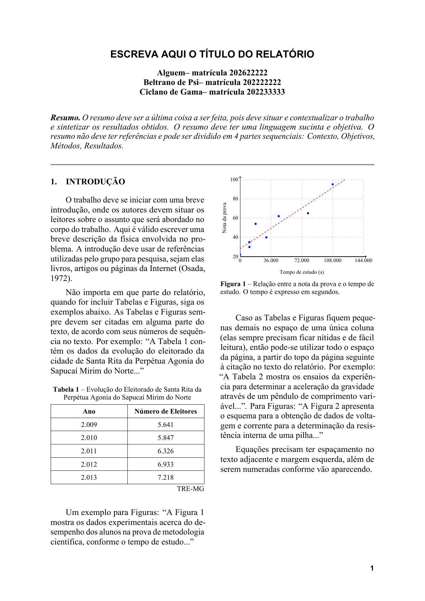
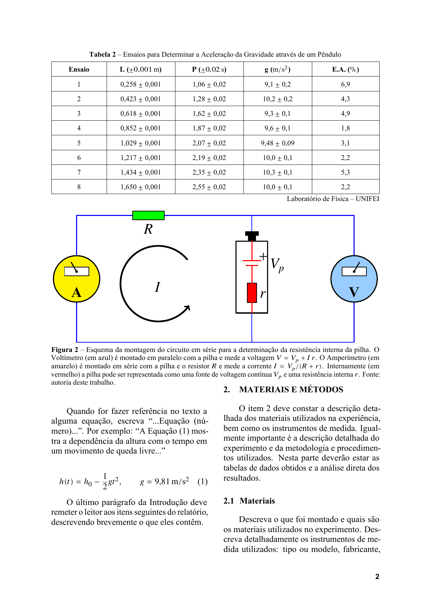
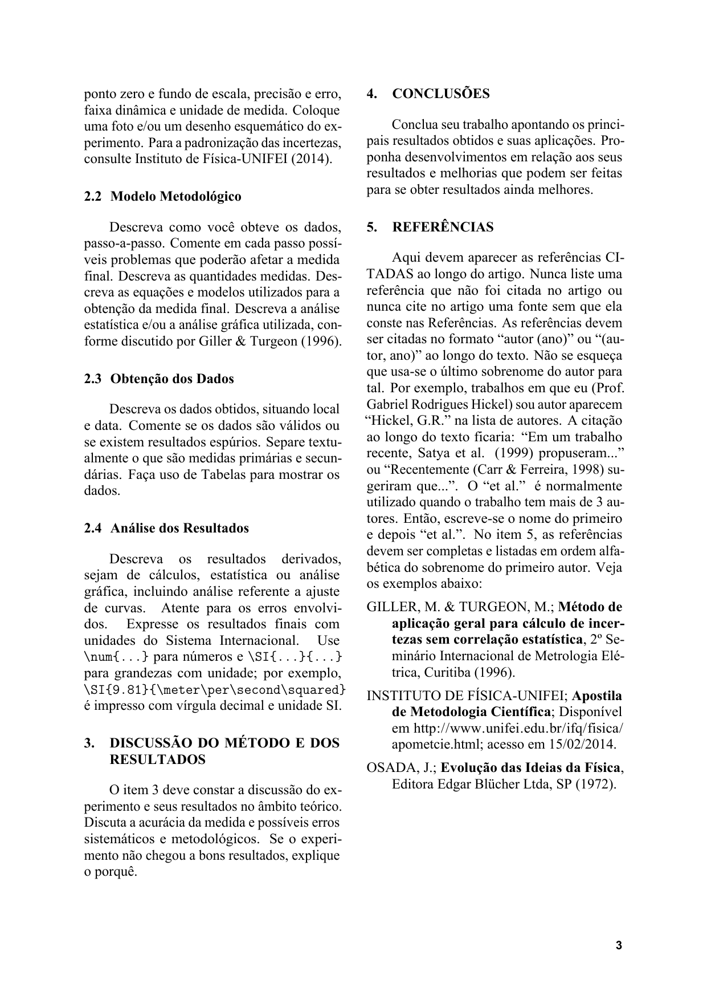

# Template de relatório científico (LuaLaTeX)

Template em LuaLaTeX que reproduz a formatação do arquivo `Relatoriomassa.doc`:
papel A4, margens de 25 mm, duas colunas, texto em Times New Roman 12 pt,
título em Arial 14 pt negrito, legendas e tabelas em 10 pt, seções numeradas,
citações no formato autor–ano e referências em ordem alfabética.

A montagem do documento é automatizada por um módulo em Lua: título, autores,
resumo, tabelas (a partir de CSV), figuras, citações e lista de referências são
gerados a partir de arquivos de configuração, sem escrever LaTeX repetitivo.

**[Veja o template compilado em PDF](main.pdf).**
****
****
****

## Requisitos

- TeX Live 2021 ou superior (ou MiKTeX atualizado) com:
  - `lualatex` e `latexmk`;
  - pacotes `fontspec`, `unicode-math`, `geometry`, `babel`, `microtype`,
    `graphicx`, `xcolor`, `array`, `tabularx`, `float`, `cuted`, `caption`,
    `tikz` (pacote PGF), `siunitx`, `titlesec`, `fancyhdr`, `indentfirst`,
    `enumitem`, `hyperref`.
- Fontes Times New Roman e Arial (Microsoft). Caso não estejam instaladas, o
  template usa automaticamente as equivalentes livres **Liberation Serif** e
  **Liberation Sans**, metricamente compatíveis.
- Fonte matemática `TeX Gyre Termes Math` (pacote `tex-gyre-math`, presente no
  TeX Live completo).

Os padrões de hifenização do português já estão incluídos em
`scripts/hyph-pt.tex` (licença BSD-3-Clause), portanto não é necessário
instalar o pacote `hyphen-portuguese` do sistema.

> O template **exige LuaLaTeX**. Não compile com pdfLaTeX: as automações
> dependem do interpretador Lua embutido.

## Compilação

No diretório do projeto:

```bash
latexmk -lualatex main.tex
```

O PDF gerado é `main.pdf`. Para uma compilação limpa:

```bash
latexmk -C && latexmk -lualatex main.tex
```

Também há um `Makefile`:

```bash
make          # compila main.pdf
make png      # converte cada página em PNG dentro de main_png/
make clean    # remove arquivos auxiliares
make distclean # remove também o PDF
```

O script também pode ser chamado diretamente:

```bash
lua scripts/pdf_para_png.lua [arquivo.pdf] [diretorio_saida] [resolucao_dpi]
```

Por padrão, converte `main.pdf` para PNGs de 150 DPI no diretório `main_png/`.
Por exemplo, `lua scripts/pdf_para_png.lua main.pdf imagens 300` gera as páginas
na resolução de 300 DPI em `imagens/`. O script requer `pdftoppm`, disponível
no pacote Poppler.

O arquivo `.latexmkrc` já fixa o modo LuaLaTeX, então `latexmk main.tex` também
funciona. O `main.tex` começa com `% !TEX program = lualatex`, diretiva
reconhecida por editores como TeXstudio, VS Code (LaTeX Workshop) e TeXShop.
Se o arquivo for compilado com pdfLaTeX por engano, o template interrompe com
uma mensagem explícita em vez do erro genérico do `fontspec`.

## Estrutura do projeto

```
.
├── main.tex                  # conteúdo do relatório
├── relatorio.cls             # classe com a formatação e a interface Lua
├── scripts/
│   ├── relatorio.lua         # interface Lua chamada pelo LaTeX
│   ├── pdf_para_png.lua      # converte o PDF em imagens PNG
│   ├── relatorio/
│   │   ├── comum.lua         # leitura de CSV e formatação numérica
│   │   ├── tabelas.lua       # geração de tabelas
│   │   ├── figuras.lua       # renderização das figuras
│   │   ├── graficos.lua     # gráficos vetoriais e ajustes
│   │   ├── referencias.lua  # citações e lista bibliográfica
│   │   └── idioma.lua       # hifenização em português
│   └── hyph-pt.tex           # padrões de hifenização do português
├── config/
│   ├── relatorio.lua         # título, autores, matrículas e resumo
│   ├── tabelas.lua           # definição das tabelas
│   ├── figuras.lua           # definição das figuras
│   └── referencias.lua       # base de referências
├── dados/
│   ├── tabela1.csv           # dados da Tabela 1
│   └── tabela2.csv           # dados da Tabela 2 (com incertezas)
├── figuras/                  # imagens externas opcionais
├── Makefile
├── .latexmkrc
└── .gitignore
```

## Como usar

### Título, autores e resumo

Edite apenas `config/relatorio.lua`:

```lua
return {
  titulo = "Escreva aqui o título do relatório",
  autores = {
    { nome = "Nome Completo", matricula = "2026000000" },
  },
  resumo = [[Texto do resumo...]],
}
```

O título é convertido para maiúsculas automaticamente e cada autor é impresso
como `Nome -- matrícula 000000`.

### Tabelas

1. Coloque os dados em um CSV em `dados/`. A primeira linha contém os nomes das
   colunas; o separador pode ser vírgula ou ponto e vírgula.
2. Declare a tabela em `config/tabelas.lua`:

```lua
tabela3 = {
  arquivo = "dados/tabela3.csv",
  legenda = "Resultados do experimento",
  rotulo = "tab:resultados",
  fonte = "Autoria deste trabalho",
  largura = "\\columnwidth",
  posicao = "H",
  colunas = {
    { titulo = "Ensaio", campo = "ensaio", formato = "texto" },
    { titulo = "Massa ($\\si{\\kilogram}$)", campo = "massa", formato = "decimal" },
    { titulo = "Tempo ($\\si{\\second}$)", campo = "tempo", campos = { "tempo", "tempo_erro" }, formato = "mais_menos" },
  },
}
```

3. No texto, use `\tabela{tabela3}` e cite com `Tabela~\ref{tab:resultados}`.

Formatos numéricos disponíveis. Os formatos numéricos são renderizados por
`\num` e respeitam as opções globais do `siunitx` (vírgula decimal e ponto
como separador de milhares):

| Formato      | Efeito                                      |
|--------------|---------------------------------------------|
| `texto`      | valor literal do CSV                        |
| `numero`     | valor numérico formatado por `siunitx`        |
| `milhar`     | valor com agrupamento de milhares              |
| `decimal`    | número decimal com vírgula                     |
| `mais_menos` | dois campos → `\num{9.1} \pm \num{0.2}`       |

Use `\num{1234.56}` para números e `\SI{9.81}{\meter\per\second\squared}`
para grandezas com unidade. A configuração global converte o ponto decimal
dos dados para vírgula na saída, agrupa milhares com ponto e usa o modo de
unidades SI. Prefira unidades SI nos títulos das colunas, legendas, gráficos
e no texto; por exemplo, escreva tempo em segundos (`\si{\second}`) e
aceleração em `\si{\meter\per\second\squared}`.

Campos opcionais: `pesos` (proporção das colunas), `espacamento_linhas`
(padrão `1.6`), `larga` (tabela de página inteira) e `largura`.

### Figuras

As figuras de exemplo são desenhadas como vetores com TikZ. Para uma fotografia
ou imagem externa, coloque o arquivo em `figuras/` e declare em
`config/figuras.lua`:

```lua
figura3 = {
  arquivo = "figuras/figura3.png",
  legenda = "Montagem experimental.",
  rotulo = "fig:montagem",
  largura = "0.9\\columnwidth",
  posicao = "H",
}
```

No texto: `\figura{figura3}` e `Figura~\ref{fig:montagem}`.

### Figuras vetoriais com TikZ e Lua

Para gráficos de dispersão, configure os pontos e os eixos em
`config/figuras.lua`:

```lua
grafico = {
  tipo = "grafico",
  pontos = { { 0, 22 }, { 10800, 30 }, { 30600, 40 }, { 45000, 62 } },
  eixo_x = {
    minimo = 0, maximo = 144000, passo = 36000,
    rotulo = "Tempo de estudo (\\si{\\second})",
  },
  eixo_y = {
    minimo = 20, maximo = 100, passo = 20,
    rotulo = "Nota da prova",
  },
  legenda = "Resultados experimentais e ajuste linear.",
  rotulo = "fig:resultados",
  largura = "\\columnwidth",
  posicao = "H",
}
```

Inclua-o no texto com `\figura{grafico}`. Lua valida e percorre os dados,
calcula o ajuste linear por mínimos quadrados e gera os comandos TikZ para
desenhar os eixos, a grade, os pontos e a reta. O resultado é vetorial e não
requer uma imagem intermediária. Outros desenhos vetoriais podem ser feitos
diretamente em ambientes `tikzpicture` no `main.tex`; a classe já carrega o
pacote TikZ.

O circuito da Figura 2 também é um desenho TikZ; sua configuração usa
`tipo = "circuito"` e não precisa de um arquivo de imagem:

```lua
figura2 = {
  tipo = "circuito",
  legenda = "Esquema do circuito experimental.",
  rotulo = "fig:circuito",
  larga = true,
  largura = "\\textwidth",
}
```

O módulo Lua foi dividido por responsabilidade em `scripts/relatorio/`.
`scripts/relatorio.lua` permanece como ponto de entrada e mantém a mesma
interface LaTeX (`Relatorio.tabela`, `Relatorio.figura` e demais comandos).

### Tabelas e figuras de página inteira

Quando a tabela ou figura não couber em uma coluna, use `larga = true` e
`largura = "\\textwidth"`. No `main.tex`, coloque os elementos dentro do
ambiente `faixa`, que ocupa a largura total sem interromper o fluxo das
colunas:

```latex
\clearpage
\begin{faixa}
  \tabela{tabela2}
  \figura{figura2}
\end{faixa}
```

### Citações e referências

Cadastre as referências em `config/referencias.lua`:

```lua
{
  chave = "osada1972",
  autores = { { sobrenome = "Osada", nome = "J." } },
  ano = "1972",
  titulo = "Evolução das Ideias da Física",
  tipo = "livro",
  editora = "Editora Edgar Blücher Ltda",
  localidade = "SP",
}
```

Tipos aceitos: `artigo`, `livro`, `evento` e `web` (com `url` e `acesso`).
Para instituição, use `autores = { { instituicao = "Nome da Instituição" } }`.

No texto:

- `\citet{osada1972}` → `Osada (1972)`
- `\citep{osada1972}` → `(Osada, 1972)`
- `\citep{osada1972,giller1996}` → `(Osada, 1972; Giller & Turgeon, 1996)`

A lista é gerada por `\referencias` e ordenada alfabeticamente pelo sobrenome do
primeiro autor, ignorando acentos.

## Como as automações funcionam

`main.tex` carrega o módulo antes do documento:

```latex
\directlua{
  Relatorio = dofile("scripts/relatorio.lua")
  Relatorio.inicializar("config")
}
```

A classe define comandos que chamam funções Lua:

| Comando             | Função Lua               |
|---------------------|--------------------------|
| `\tabela{id}`       | `Relatorio.tabela(id)`   |
| `\figura{id}`       | `Relatorio.figura(id)`   |
| `\citet{chave}`     | `Relatorio.citar(...)`   |
| `\citep{chave}`     | `Relatorio.citar(...)`   |
| `\referencias`      | `Relatorio.referencias()`|

As funções leem os arquivos de `config/` e os CSV de `dados/`, montam o LaTeX e
o enviam ao documento com `tex.sprint`. Por isso, **compile a partir da raiz do
projeto**: os caminhos são relativos.

O módulo também registra o português e carrega os padrões de hifenização de
`scripts/hyph-pt.tex` por meio de `Relatorio.hifenizacao()`. Isso mantém a
hifenização correta mesmo em instalações do TeX Live sem o pacote
`hyphen-portuguese`.

## Formatação implementada

- A4, margens de 25 mm, duas colunas com 8 mm de separação.
- Times New Roman 12 pt (Liberation Serif como alternativa) e entrelinha
  simples.
- Título em Arial 14 pt negrito, centralizado; autores em negrito.
- Resumo em itálico logo abaixo do título, seguido de uma linha horizontal.
- Seções numeradas (`1.`, `2.`, ...), em maiúsculas e negrito; subseções
  (`2.1`, ...).
- Legendas de tabela acima e centralizadas; de figura abaixo e justificadas,
  ambas em 10 pt.
- Tabelas em 10 pt, com linhas horizontais e fonte alinhada à direita.
- Número de página em Arial negrito 10 pt no rodapé direito.
- Equações numeradas e com espaçamento adequado.
- PDF com metadados e links internos.

## Solução de problemas

- **`Relatorio` é `nil` ou arquivo não encontrado**: compile na raiz do projeto
  e confirme que `scripts/relatorio.lua` e `config/` existem.
- **Fonte diferente da esperada**: instale Times New Roman/Arial ou aceite a
  substituição por Liberation; confira o aviso no `main.log`.
- **Tabela larga fora de lugar**: use `\begin{faixa}...\end{faixa}` e
  `\clearpage` antes, como no exemplo do `main.tex`.
- **Caracteres estranhos em CSV**: salve em UTF-8 (o BOM é removido
  automaticamente).
- **Aviso `No hyphenation patterns were preloaded ... Portuguese`**: verifique
  se `scripts/hyph-pt.tex` existe e se `main.tex` chama
  `Relatorio.hifenizacao("scripts/hyph-pt.tex")` antes de `\begin{document}`.
  Com os padrões incluídos, esse aviso não deve aparecer.
